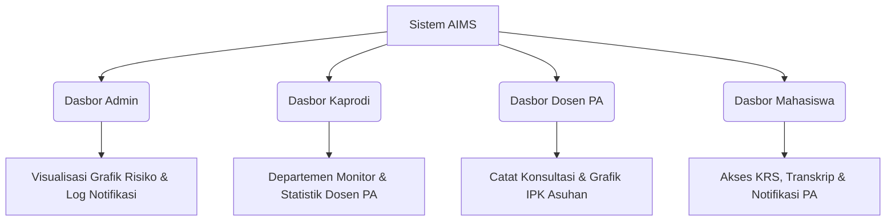

# Panduan Pengguna & Fitur Terpadu AIMS (Academic Integrated Management System)

AIMS adalah platform cerdas yang dirancang sebagai pintu gerbang utama dalam koordinasi akademik, pelacakan evaluasi, dan sistem peringatan dini (*Early Warning System*) di tingkat **Fakultas Ilmu Budaya (FIB) Universitas Hasanuddin**. Platform ini menghubungkan empat peran kunci secara terintegrasi: **Super Admin**, **Ketua Program Studi (Kaprodi)**, **Dosen Penasihat Akademik (PA)**, dan **Mahasiswa**.

---

## 🌟 Fitur Utama AIMS

### 1. Sinkronisasi Data NeoSIA Terpadu
Sistem terus-menerus diselaraskan dengan portal resmi **NeoSIA** secara satu arah (*read-only*) untuk mengambil data otentik tanpa risiko mengubah data master universitas. Data yang disinkronkan meliputi:
- Profil Lengkap Mahasiswa & Dosen PA.
- Riwayat KRS Aktif & Transkrip Nilai lengkap.
- Pembagian bimbingan resmi mahasiswa di bawah Dosen PA.

### 2. Early Warning System (Sistem Deteksi Risiko Akademik)
Sistem secara proaktif mendeteksi mahasiswa yang memiliki potensi kendala akademik atau keterlambatan kelulusan berdasarkan dua parameter utama:
- **Status Evaluasi Berjangka**: Sinkronisasi status riil dari NeoSIA (termasuk deteksi status kritis `Drop Out` dan `Non Aktif`).
- **Masa Studi Efektif**: Mahasiswa aktif dengan masa studi mendekati batas maksimal (Angkatan $\ge$ 7 tahun diatur sebagai `HIGH_RISK`, Angkatan 5–6 tahun sebagai `Warning`, Angkatan < 5 tahun sebagai `Aman`).

### 3. Logika Peringatan Notifikasi Otomatis
Jika sistem mendeteksi tingkat risiko mahasiswa meningkat:
- **WhatsApp**: Pesan peringatan langsung dikirimkan ke nomor WhatsApp aktif mahasiswa.
- **Telegram**: Notifikasi siaran otomatis dikirimkan ke bot Telegram pendamping.
- **Email**: Pengingat berkala berisi rincian SKS & IPK diantarkan ke kotak masuk mahasiswa.

### 4. Dasbor Terintegrasi Berdasarkan Peran (Role-Based Dashboard)
Setiap aktor memiliki halaman antarmuka khusus dengan representasi grafik visual yang modern dan interaktif:

### 5. Manajemen Profil & Akun Mandiri
Semua jenis pengguna memiliki hak akses penuh untuk melakukan konfigurasi akun mereka sendiri di halaman sidebar masing-masing melalui tombol **Pengaturan Profil**:
- Mengubah username login.
- Mengubah kata sandi secara aman.
- Memperbarui email aktif dan nomor WhatsApp untuk sistem notifikasi.

---

## 📖 Panduan Penggunaan Dasbor & Alur Kerja

### A. Dasbor Super Admin (`/admin`)
Dasbor terpusat untuk memantau performa akademik fakultas secara makro:
1. **Statistik Kumulatif**: Memantau total mahasiswa aktif, jumlah dosen PA, dan log notifikasi terkirim.
2. **Grafik Risiko per Prodi**: Grafik batang bertingkat (*Stacked Bar Chart*) yang menampilkan perbandingan jumlah mahasiswa berstatus `HIGH_RISK` dan `Warning` di seluruh 15 prodi FIB.
3. **Log Siaran**: Meninjau semua log pengiriman pesan keluar (WhatsApp, Telegram, Email).
4. **Pengaturan Profil**: Mengubah kredensial dan kontak Admin.

### B. Dasbor Ketua Program Studi (`/prodi`)
Dirancang bagi Kaprodi untuk mengawasi ketepatan masa studi di departemennya:
1. **Filter Angkatan Ringkas**: Menampilkan daftar mahasiswa dari tahun 2019 hingga 2025 secara instan.
2. **Monitoring Dosen PA**: Mengamati daftar dosen wali di bawah prodi tersebut beserta jumlah mahasiswa berisiko yang mereka bimbing.
3. **Analisis Risiko**: Menyajikan data spesifik mahasiswa berstatus `HIGH_RISK` (seperti mahasiswa semester akhir yang terancam Drop Out).
4. **Penerbitan Catatan Akademik**: Membuat memo/catatan resmi untuk ditujukan kepada Dosen PA tertentu guna menindaklanjuti mahasiswa yang kritis.

### C. Dasbor Dosen Penasihat Akademik (`/advisor`)
Alat bantu bagi Dosen PA untuk melakukan bimbingan secara interaktif:
1. **Daftar Mahasiswa Asuhan**: Melihat detail data bimbingannya sendiri termasuk perkembangan IPK & SKS kumulatif.
2. **Grafik IPK per Mahasiswa**: Visualisasi grafik garis/batang performa IPK mahasiswa asuhan untuk mendeteksi penurunan nilai secara dini.
3. **Riwayat Konsultasi**: Mencatat tanggal, tipe bimbingan (Konsultasi Akademik, Rencana Studi, Evaluasi Semester), status, serta catatan bimbingan mahasiswa.
4. **Notifikasi Masuk**: Menerima memo/instruksi khusus langsung dari Kaprodi terkait bimbingannya.

### D. Portal Mahasiswa (`/student`)
Ruang pribadi bagi mahasiswa untuk memantau kelayakan belajarnya:
1. **Jadwal & KRS Aktif**: Melihat jadwal kuliah berjalan dan SKS yang diambil yang tersinkronisasi dari portal NeoSIA.
2. **Riwayat Nilai**: Mengontrol perolehan Indeks Prestasi Semester (IPS) dan Indeks Prestasi Kumulatif (IPK) tiap semester secara transparan.
3. **Catatan PA**: Membaca arahan dan saran bimbingan yang dikirimkan oleh Dosen PA-nya. Mahasiswa dapat menandai saran tersebut sebagai "Selesai" dan menyembunyikannya dari dasbor aktif jika kendala telah diselesaikan.

---

## 🔑 Kredensial Akses Akun Uji Coba (Demo)

Semua akun dalam sistem uji coba dikonfigurasi dengan kata sandi default: **`password123`**

### 1. Dasbor Super Admin
- **Username**: `admin`
- **Password**: `password123`

### 2. Dasbor Kaprodi (PRODI)
- **Contoh Akun**:
  - `prodi_sastra_prancis` (Sastra Prancis)
  - `prodi_sastra_inggris` (Sastra Inggris)
  - `prodi_sastra_indonesia` (Sastra Indonesia)
  - `prodi_sastra_arab` (Sastra Arab)

### 3. Dasbor Dosen Penasihat Akademik (ADVISOR)
- **Username**: Silakan gunakan Nomor Induk Pegawai (NIP) dosen, sebagai contoh:
  - `198109082018074001` (Dra. Herawaty, M.Hum., Ph. D)
  - `197911172010122002` (Haeruddin, SS., MA.)
  - `PA_FRN1` / `PA_FRN2`

### 4. Portal Mahasiswa (STUDENT)
- **Username**: Silakan gunakan NIM Mahasiswa, sebagai contoh:
  - `F011241001` (Sastra Indonesia)
  - `F041251194` (Sastra Inggris)
  - `F031241001` (Sastra Arab)
